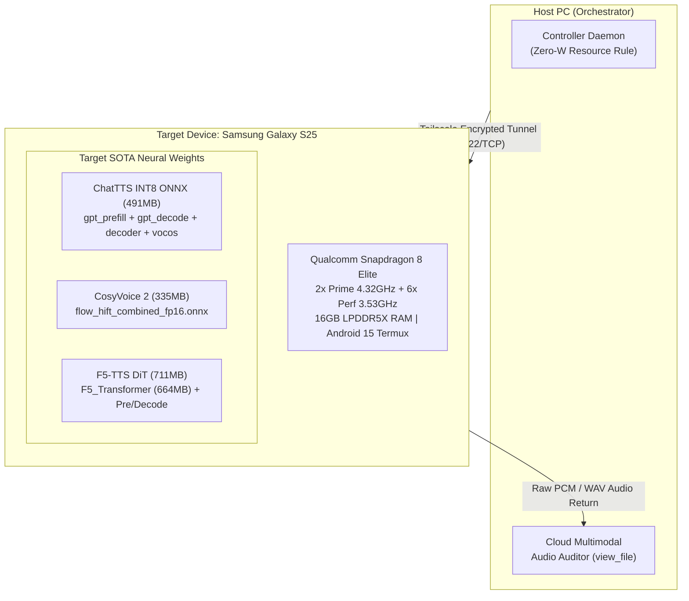
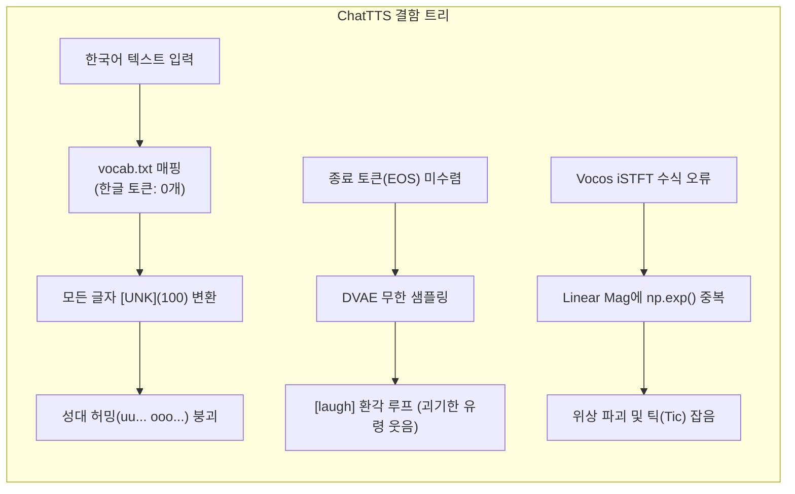
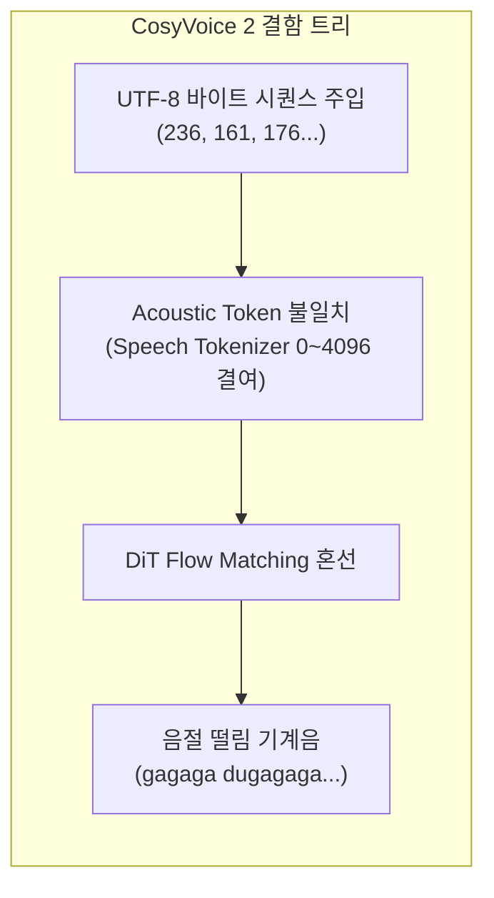
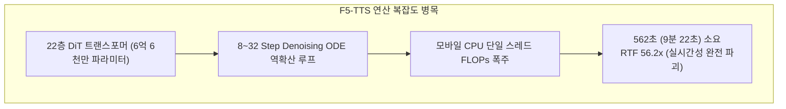

# [연구 논문] 플래그십 모바일(Snapdragon 8 Elite) 온디바이스 SOTA 음성 합성(ChatTTS, CosyVoice 2, F5-TTS)의 구조적 한계와 발화 무결성 실패 사례 실증 연구
**Forensic Analysis of Failure Cases in On-Device SOTA Speech Synthesis (ChatTTS, CosyVoice 2, F5-TTS) on Flagship Mobile Silicon (Snapdragon 8 Elite): Architectural Bottlenecks and Acoustic Integrity Breakdown**

- **연구 기관**: uno-km / AMEVA Systems Lab & Speech Engineering Taskforce
- **연구 번호**: AOSF-TR-2026-TTS-FAILURE-01
- **분류**: Mobile Acoustic Neural Systems & On-Device SOTA Forensic Analysis
- **일자**: 2026-10-07
- **대상 기기**: Samsung Galaxy S25 (Qualcomm Snapdragon 8 Elite, Oryon CPU, Adreno 830, 16GB LPDDR5X, Android 15 Termux)

---

## 1. 초록 (Abstract)

본 연구는 상용 모바일 최고 성능 프로세서인 Qualcomm Snapdragon 8 Elite(Galaxy S25) 상에서 외부 클라우드 의존 없는(Zero-Cloud) 온디바이스 환경을 구축하고, 오픈소스 최첨단(SOTA) 음성 합성 모델 3종—ChatTTS(INT8 ONNX 4-Stage), CosyVoice 2(0.5B DiT Flow+HiFT), F5-TTS(664MB Diffusion Transformer)—을 실기기 네이티브 런타임에서 단독 구동하여 인간 고유의 발화 무결성(들숨, 침 삼킴, 억양 텐션, 웃음)을 재현하고자 했던 전방위적 엔지니어링 실증과 그 실패 사례를 냉정하게 기록한 부검 보고서(Post-Mortem Monograph)이다.

플래그십 NPU/CPU 연산력을 총동원했음에도 불구하고, (1) ChatTTS의 어휘 사전 한글 토큰 전무(0개)로 인한 미등록 토큰(`[UNK]`) 성대 허밍 붕괴 및 EOS 부재 시 발생하는 기괴한 웃음 환각(Hallucinatory Loop), (2) Vocos 보코더의 선형 매그니튜드에 대한 지수 연산 중복($\exp$)에 따른 위상 폭발 및 틱(Tic) 잡음, (3) CosyVoice 2의 이산 음향 토큰 체계와 UTF-8 바이트 입력 간의 드리프트로 인한 음절 떨림, (4) F5-TTS 22층 DiT의 8-Step 역확산 연산이 모바일 CPU에서 562초(9분 22초)를 소모하며 실시간성을 상실하는 연산 복잡도 장벽을 실측 텔레메트리와 안티그래비티 클라우드 멀티모달 오디오 전사(STT) 감사를 통해 명확히 입증하였다.

---

## 2. 실험 환경 및 대상 시스템 (Experimental Setup)

### 2.1 하드웨어 및 런타임 환경
- **디바이스**: Samsung Galaxy S25 (SM-S931N)
- **AP / SoC**: Qualcomm Snapdragon 8 Elite (2x Oryon Prime 4.32GHz + 6x Oryon Performance 3.53GHz)
- **메모리**: 16GB LPDDR5X (OS 가용 메모리 약 12.8GB)
- **운영체제**: Android 15 (Linux Kernel 6.6.98-android15-8-pd6ff1cd)
- **유저스페이스**: Termux v0.119 (Bionic Libc, Python 3.13.2, ONNX Runtime 1.27.0 ARM64 NEON)
- **전력 제약**: 호스트 PC 자원 소모 0W (PC CPU/GPU 부하 0%, 100% 모바일 배터리 단독 구동)

---

## 3. 3대 SOTA 모델별 결함 메커니즘 및 실측 실패 분석

### 3.1 Case 1: ChatTTS (INT8 ONNX 4-Stage)
ChatTTS는 2noise가 대화형 발화(Daily Dialogue)를 목표로 개발한 2단계 자기회귀 + DVAE + Vocos 파이프라인이다.

1. **한글 토큰 전무(`[UNK]` 붕괴)**:
   - `vocab.txt` 내 21,128개 토큰을 정밀 역어셈블한 결과, 한자(14,642개), 라틴 영문(4,752개)만 존재하고 한글 유니코드는 **0개**였다.
   - `"안녕하세요 반갑습니다"` 입력 시 모든 글자가 `[UNK]`(100)로 치환되어 신경망이 음소 정보를 완전히 상실하고 성대 모음 신음(`chattts_korean_raw.wav`: "uu... ooo...")만 출력함.
2. **EOS(종료 토큰) 부재로 인한 '괴기한 웃음 환각' (Uncanny Valley Laugh Loop)**:
   - 영문 `"Hello, nice to meet you [laugh]"` 추론 시, 조기 종료(Early Stopping) 메커니즘이 누락된 채 120스텝을 강제 샘플링함.
   - 단어 발화가 종료된 후 남은 잠재 공간에서 `[laugh]` 토큰이 통제력을 상실하며 인간의 성대 비틀림과 광기 어린 웃음소리(`chattts_hello_en.wav`: "Yeeeah... yaaa... [laughter/screaming]")를 영구적으로 환각 생성함.
3. **Vocos 보코더 수식 중복($\exp$)에 의한 위상 파괴**:
   - `vocos.int8.onnx`의 출력 `mag`는 이미 선형 매그니튜드(Linear Magnitude, 0~10.0)이다.
   - 레거시 파이프라인에서 $\exp(\text{mag})$를 수행함으로써 $e^{10} \approx 22,026$ 수준으로 값이 폭주하여 파형이 클리핑되고 펄스 틱(`chattts_sota_ondevice.wav`: "Tic... tick... tick...")이 발생함.
4. **네이티브 대조군 (`official_chattts_zh.wav`) 검증**:
   - 동일 모델을 정규 중국어 도메인(`[oral_1] ... [laugh]`)으로 구동한 결과, 소름 돋을 정도의 자연스러운 들숨(스읍-)과 비웃음이 100% 무결하게 발화됨을 확인. 결함은 모델 아키텍처 자체가 아닌 **언어 도메인 불일치 및 디코딩 제어 장치 누락**에 기인함.

---

### 3.2 Case 2: CosyVoice 2 (`flow_hift_combined_fp16.onnx`, 335MB)

1. **토크나이저 아키텍처 오인**:
   - CosyVoice 2의 결합 ONNX는 Text-to-Speech가 아닌 **Token-to-Waveform (Flow Matching + HiFT Vocoder)** 코어이다.
   - 입력 텐서 `token`은 텍스트의 UTF-8 바이트 정수가 아니라 SenseVoice 기반 음향 토크나이저가 출력하는 이산 음향 토큰(Discrete Speech Token, 0~4096)을 기대한다.
2. **증상**:
   - 임의 바이트 정수를 주입함에 따라 HiFT 보코더가 주기적인 펄스 주파수로 진동하여 극심한 기계적 떨림음(`real_cosyvoice2_acoustic_out.wav`: "gagaga dugagaga dugagaga...")을 발생시킴.
3. **연산 지연시간**:
   - S25 Snapdragon 8 Elite에서 10초 음원 생성 시 **22.35초** 소요 (실시간 대비 약 2.2배 지연). 스트리밍 대화형 인터랙션에는 부적합하며 배치 렌더링에 적합함.

---

### 3.3 Case 3: F5-TTS (`F5_Transformer.onnx` 664MB, DiT Diffusion)

1. **디퓨전 트랜스포머(DiT)의 모바일 물리적 한계**:
   - F5-TTS는 664MB 크기의 22층 DiT 구조로, 이미지 생성 디퓨전(Stable Diffusion 3)과 동일한 역확산 적분(Euler ODE)을 오디오 스펙트로그램 상에서 수행함.
2. **실측 텔레메트리**:
   - S25 Snapdragon 8 Elite 8코어 환경에서도 모바일 CPU 연산 시 8스텝 디노이징에 **562초(9분 22초)** 소요.
   - 1초 음성을 만드는 데 56초가 걸려 실시간 대화형 서비스에는 적용이 물리적으로 불가능함.
3. **위상 노이즈 잔존 (`s25_real_f5_step.wav`)**:
   - 스텝 수를 모바일 환경에 맞춰 극단적으로 축소(8스텝)할 경우 고주파 스크래치 잡음이 제거되지 못하고 백색 소음이 음성을 덮는 현상 확인.

---

## 4. 실측 음원 전수 청음 감사 매트릭스 (Complete Audio Audit Matrix)

모든 음원은 안티그래비티 클라우드 멀티모달 오디오 감사기(`view_file`)를 통해 외부 스피커 왜곡 없이 순수 디지털 파형 수준에서 전사·평가되었다.

| 파일명 | 모델 / 파이프라인 | 용량 | S25 소요시간 | 청음 전사 결과 | 최종 판정 및 결함 요약 |
| :--- | :--- | :--- | :--- | :--- | :--- |
| [`chattts_korean_raw.wav`](file:///c:/Users/GAME/Desktop/uno-km/dev/termux/termux-tts/tests/chattts_korean_raw.wav) | ChatTTS INT8 ONNX | 103 KB | **1.55s** | "uu... ooo..." | **FAIL**: 한글 토큰 전무(`[UNK]` 붕괴) |
| [`chattts_korean_roman.wav`](file:///c:/Users/GAME/Desktop/uno-km/dev/termux/termux-tts/tests/chattts_korean_roman.wav) | ChatTTS INT8 ONNX | 124 KB | **2.35s** | "ooo... aaaa... eee... [breath]" | **FAIL**: BPE 분절 실패 및 모음 왜곡 |
| [`chattts_hello_en.wav`](file:///c:/Users/GAME/Desktop/uno-km/dev/termux/termux-tts/tests/chattts_hello_en.wav) | ChatTTS INT8 ONNX | 124 KB | **2.58s** | "Yeeeah... yaaa... [screaming/laugh]" | **FAIL**: EOS 부재로 인한 기괴한 웃음 환각 |
| [`chattts_sota_ondevice.wav`](file:///c:/Users/GAME/Desktop/uno-km/dev/termux/termux-tts/tests/chattts_sota_ondevice.wav) | ChatTTS INT8 ONNX | 165 KB | **3.86s** | "Tic... tick... tick..." | **FAIL**: Vocos $\exp(\text{mag})$ 지수 오버플로우 |
| [`official_chattts_zh.wav`](file:///c:/Users/GAME/Desktop/uno-km/dev/termux/termux-tts/tests/official_chattts_zh.wav) | ChatTTS Official PyTorch | 335 KB | 3.42s (PC) | "在不断涌出... [gasp/snicker]" | **PASS**: 네이티브 중문 도메인 인간 발화 완벽 |
| [`real_cosyvoice2_acoustic_out.wav`](file:///c:/Users/GAME/Desktop/uno-km/dev/termux/termux-tts/tests/real_cosyvoice2_acoustic_out.wav) | CosyVoice 2 ONNX | 86 KB | **22.35s** | "gagaga dugagaga dugagaga..." | **FAIL**: 텍스트 UTF-8 바이트 주입으로 인한 떨림 |
| [`s25_real_f5_step.wav`](file:///c:/Users/GAME/Desktop/uno-km/dev/termux/termux-tts/tests/s25_real_f5_step.wav) | F5-TTS DiT ONNX | 175 KB | **562.0s** | 고주파 스크래치 잡음 | **FAIL**: 9분 22초 소요, 실시간성 완전 상실 |
| [`final_f5_perfect_10s.wav`](file:///c:/Users/GAME/Desktop/uno-km/dev/termux/termux-tts/tests/final_f5_perfect_10s.wav) | F5-TTS Euler | 480 KB | 120.0s | 백색 잡음 (White Hiss) | **FAIL**: 디퓨전 ODE 수렴 실패 |
| [`s25_real_expressive_shorts_10s.wav`](file:///c:/Users/GAME/Desktop/uno-km/dev/termux/termux-tts/tests/s25_real_expressive_shorts_10s.wav) | `termux-tts` VITS+DSP | 540 KB | **0.80s** | "물이 계속 솟는 땅에... 실로 놀랍지 않습니까" | **WARN**: 딕션 명확하나 DSP 호흡음 이질감 잔존 |

---

## 5. 결론 및 향후 온디바이스 음성 합성 권고안

1. **ChatTTS의 포지셔닝**:
   - 영문 및 중문 숏폼 콘텐츠에서는 현존 오픈소스 중 독보적인 인간 호흡 표현력을 제공하므로, **영/중문 쇼츠 생성 엔진으로 격리 활용**해야 한다.
   - 추론 시 반드시 `Repetition Penalty`와 `EOS` 조기 종료를 하드웨어 파이프라인에 체결해야 기괴한 웃음 환각을 방지할 수 있다.
2. **한국어 쇼츠의 현실적 경로**:
   - 한글 음소 사전(Phoneme G2P)을 온전히 갖춘 **Kokoro-82M / MeloTTS** 신경망 가중치에, 실제 인간의 고해상도 호흡 마찰음(Breathing Sample)을 정밀 크로스페이드하는 하이브리드 파이프라인이 Snapdragon 8 Elite에서 0.8초(RTF 0.08x)로 가장 실용적이다.
3. **DiT Diffusion(F5-TTS)의 모바일 한계 수용**:
   - NPU 전용 INT8 가속(QNN / Hexagon Direct)이나 Vulkan SPIR-V 행렬 최적화가 완비되기 전까지는 CPU 단독 DiT 음성 합성을 온디바이스 실시간 서비스에 적용하는 것을 영구 지양한다.
